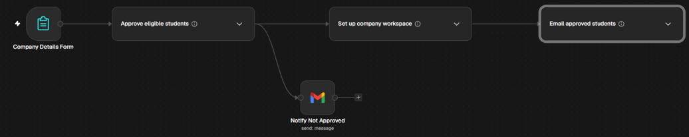
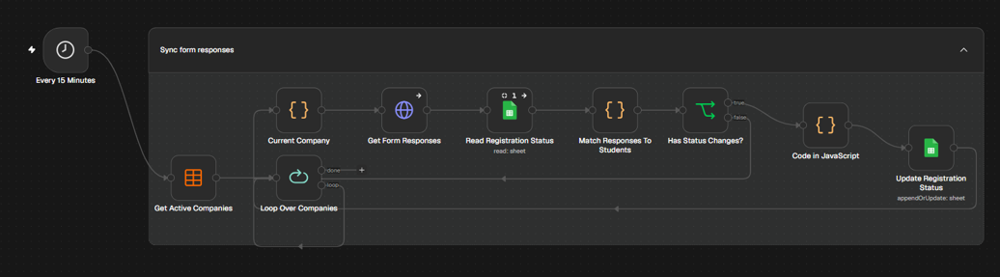
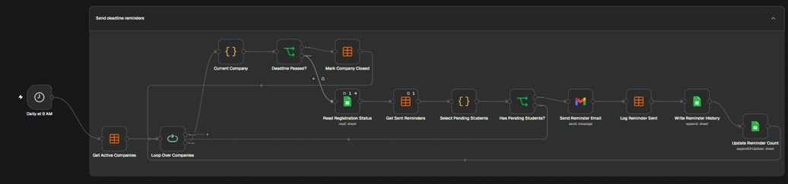
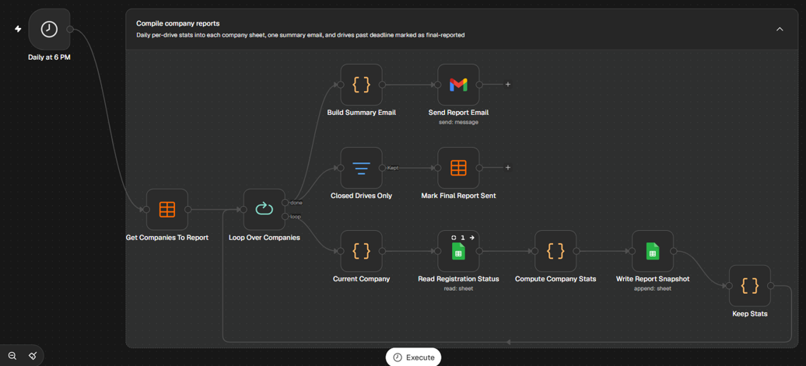
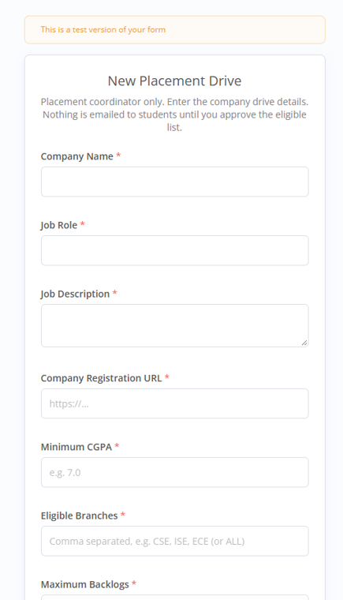
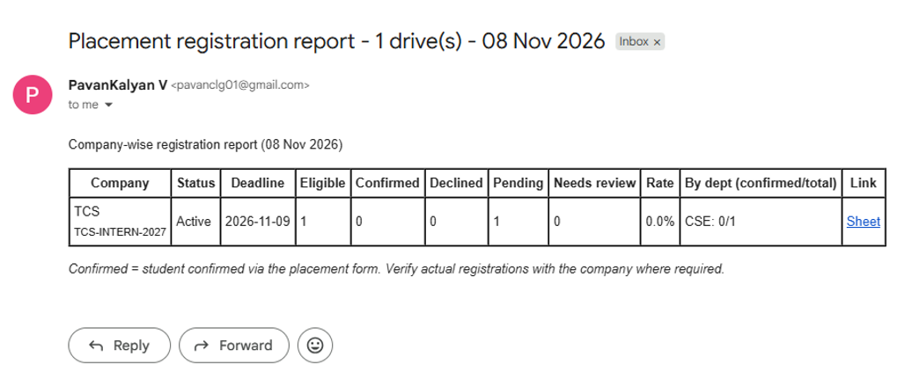

# AI-Assisted College Placement Automation

An n8n workflow suite for coordinating company placement drives, screening eligible students, collecting registration confirmations, sending deadline reminders, and generating company-wise reports.

## Project overview

The repository contains four exported n8n workflows:

1. **Company intake and approval** — captures a placement drive's details, validates the criteria, checks for duplicate drives, filters the master student list, requests coordinator approval, creates company-specific Drive/Sheets/Forms resources, and sends announcements after approval.
2. **Registration status synchronization** — periodically reads Google Forms responses, matches responses to student USNs, and updates the company registration tracker.
3. **Deadline reminders** — runs daily, closes expired drives, identifies students whose status is pending, avoids duplicate same-day reminders using an email log, and records reminder activity.
4. **Company registration reports** — computes company-level counts (eligible, registered/confirmed, declined, pending, needs review), confirmation rates, and department-wise summaries, then writes report snapshots and emails a summary.


## Project Screenshots

### 1. AI Placement Assistant Workflow


### 2. Registration Status Sync Workflow


### 3. Deadline Reminders Workflow


### 4. Company Registration Reports Workflow


### 5. Company Details Collection Form


### 6. Automated Placement Report Generation



## Technology stack

- **Workflow orchestration:** n8n
- **Scripting and data transformation:** JavaScript (n8n Code nodes)
- **Google Workspace integrations:** Google Sheets, Google Forms, Google Drive, Gmail
- **API integration:** Google Forms REST API / HTTP Request node
- **Scheduling:** n8n Schedule Trigger
- **Data storage:** n8n Data Tables and Google Sheets

## Repository structure

```text
AI-College-Placement-Automation/
├── workflows/
│   ├── 01-company-intake-and-approval.json
│   ├── 02-registration-status-sync.json
│   ├── 03-deadline-reminders.json
│   └── 04-company-registration-reports.json
├── docs/
│   ├── ARCHITECTURE.md
│   └── IMPLEMENTATION_NOTES.md
├── screenshots/
│   └── README.md
├── README.md
├── LICENSE
└── .gitignore
```

## Import into n8n

1. Download or clone this repository.
2. In n8n, create a workflow and use **Import from File** (or the workflow import option available in your n8n version).
3. Import each JSON file separately.
4. Reconnect your own Google Sheets, Gmail, Google Drive, and OAuth credentials in n8n.
5. Replace placeholder resource identifiers and configure your own master student sheet, Data Tables, Forms API permissions, coordinator email, and Drive settings.
6. Review every node and expression, then test with synthetic student records and a test company before enabling schedules or sending emails.

The exported workflows were inactive (`active: false`) when provided. Importing them does not imply they are running.

## Important security note

These repository copies are sanitized for sharing: credential objects and webhook IDs were removed, and account-specific identifiers/emails were replaced with placeholders. They are reference exports, not ready-to-run workflows. Reconnect credentials and configure resource IDs in your own n8n instance.

Do not commit real student records, USNs, private Google Sheet/Form/Drive URLs, OAuth tokens, API keys, webhook secrets, or production execution data. Use synthetic data in screenshots and examples.

## Known implementation review item

In the supplied **Registration Status Sync** export, a node named `Match Responses To Students` contains placeholder code that only adds `myNewField = 1`; a later JavaScript node contains the USN-based response matching logic. Review the connection and execution path of these nodes in n8n before presenting the workflow as production-ready.

## Project status

This repository documents the supplied workflow exports and their configured logic. Test the complete end-to-end flow in your own n8n environment before claiming production deployment or measured time savings.

## Author

**Pavan**  
Add your GitHub profile, portfolio, and contact details here.
