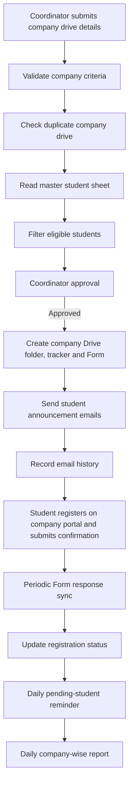

# Architecture

## High-level workflow

## Workflow responsibilities

| Workflow | Trigger | Main responsibility | Key integrations |
|---|---|---|---|
| Company intake and approval | Coordinator form submission | Validate drive, screen students, request approval, create resources, announce drive | n8n Form, Google Sheets, Drive, Forms API, Gmail, Data Tables |
| Registration status sync | Every 15 minutes | Read form responses and update student registration statuses | Schedule Trigger, HTTP Request, Google Forms API, Google Sheets, Data Tables |
| Deadline reminders | Daily at 9 AM | Close expired drives and remind pending students while logging sent reminders | Schedule Trigger, Data Tables, Google Sheets, Gmail |
| Company registration reports | Daily at 6 PM | Calculate company metrics, save report snapshots, email summary | Schedule Trigger, Data Tables, Google Sheets, Gmail |

## Data flow

- **Company intake:** Company criteria are captured from a coordinator-facing form. Student records are read from the master spreadsheet and filtered using branch, CGPA, backlog, placement-status (if available), and graduation-year (if available) fields.
- **Approval gate:** The workflow requests coordinator approval before creating company resources and sending student announcements.
- **Registration tracking:** Company-specific forms collect student confirmation. The synchronization workflow matches form responses to student USNs and updates the registration status sheet.
- **Reminders:** Pending records are selected for reminder emails. A reminder log is checked to avoid sending the same company/student/day reminder more than once.
- **Reporting:** Registration rows are aggregated into company-level and department-level metrics and stored in a report sheet.

## Important distinction

A student's form response is a self-reported confirmation. It is not independent verification that the student completed the company's external portal registration.
